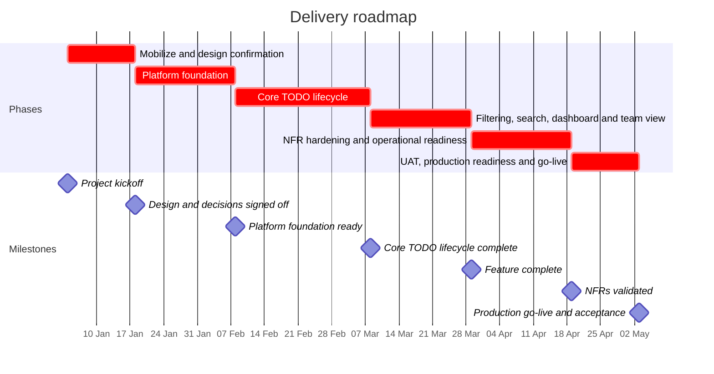

# Project Plan: XATA TODO Management Platform

> Durations, team size and dates are **estimates** informed by the supplied planning inputs. Weeks are calculated from phase durations and dependencies.

## 1. Proposal review

### Business objectives

- Replace email, spreadsheets, chat and personal notes with a single centralized web application for managing TODO items, keeping the first release intentionally small and easy to use. [XATA_TODO_BRD-002] [XATA_TODO_BRD-003]
- Let users quickly create and update TODOs, assign them to one another, and manage basic priority and due dates. [XATA_TODO_BRD-004]
- Give visibility of open, completed and overdue work through a simple dashboard, and reduce reliance on spreadsheets, email and chat for TODO tracking. [XATA_TODO_BRD-004] [XATA_TODO_BRD-011]
- Meet the agreed non-functional targets (performance, availability, security, data integrity, backup and recovery, usability, maintainability) before production acceptance. [XATA_TODO_NFR-002] [XATA_TODO_NFR-016] [XATA_TODO_NFR-017]

### Scope: in

- User login and basic user profile; role-based access for Employee, Team Lead and Administrator. [XATA_TODO_BRD-005] [XATA_TODO_BRD-007]
- Create, view, edit, delete and complete TODOs, with title, description, optional notes, status, priority and due date. [XATA_TODO_BRD-005] [XATA_TODO_BRD-008-A] [XATA_TODO_BRD-009] [XATA_TODO_BRD-010]
- Assign TODOs to users, with a basic team view of assigned TODOs for Team Leads. [XATA_TODO_BRD-005] [XATA_TODO_BRD-008-B]
- Filter and search TODOs; dashboard showing TODO status counts, including High/Critical items listed in section 7.3. [XATA_TODO_BRD-005] [XATA_TODO_BRD-008-B] [XATA_TODO_BRD-011]
- Audit information (created-by, created-date, updated-by, updated-date). [XATA_TODO_BRD-005] [XATA_TODO_BRD-008-B]
- Web interface for supported browsers (for example Chrome and Edge), responsive for desktop and tablet. [XATA_TODO_BRD-008-B] [XATA_TODO_NFR-008] [XATA_TODO_NFR-013]
- Non-functional delivery: performance, availability, security, backup/DR, observability, accessibility and maintainability, with documented APIs and tests. [XATA_TODO_NFR-003] [XATA_TODO_NFR-004] [XATA_TODO_NFR-006] [XATA_TODO_NFR-010] [XATA_TODO_NFR-011] [XATA_TODO_NFR-012] [XATA_TODO_NFR-015]

### Scope: out

- Advanced project management, Gantt charts, time tracking and resource capacity planning. [XATA_TODO_BRD-006]
- Chat or collaboration features, and file/document management. [XATA_TODO_BRD-006]
- AI-generated TODOs, native mobile applications, complex workflow approvals and external customer access. [XATA_TODO_BRD-006]

### Assumptions

- XATA will provide the user list and team structure, and the branding requirements. [XATA_TODO_BRD-013]
- The initial release is web-based and runs in a single enterprise environment. [XATA_TODO_BRD-013]
- XBS proposes the technical architecture from the BRD and NFR, and agrees it with XATA. [XATA_TODO_BRD-013] [XATA_TODO_BRD-016]
- Accessibility target is WCAG 2.1 AA 'where practical' (Should priority). [XATA_TODO_NFR-009] [XATA_TODO_NFR-017]

### Constraints

- Performance: 95% of normal page/API requests, create/update and search/filter must take 2 seconds or less. Dashboard must load within 3 seconds. At least 500 concurrent users. [XATA_TODO_NFR-003]
- Availability of at least 99.5% a month, excluding agreed maintenance. Maintenance must be communicated at least 24 hours ahead. Service must be restored within 30 minutes after an application failure. [XATA_TODO_NFR-004]
- Backup and recovery: RPO 15 minutes (unless XATA agrees otherwise) and RTO 30 minutes. Recovery procedures must be documented and tested periodically. [XATA_TODO_NFR-012] [XATA_TODO_NFR-015]
- Security: authentication before protected functions, role-based authorization, TLS in transit, no hard-coded credentials, and protection against injection, broken access control and XSS. [XATA_TODO_NFR-006]
- Support at least 100,000 TODO records initially without major redesign. [XATA_TODO_NFR-005]
- Data retention and deletion must follow XATA policy, and logs must not contain sensitive information. [XATA_TODO_NFR-007] [XATA_TODO_NFR-014]
- XBS must demonstrate NFR compliance through testing, evidence, configuration review and operational validation before production acceptance. [XATA_TODO_NFR-016]
- Must priorities: Security, Performance, Availability, Data Integrity, Backup & Recovery, Usability, Maintainability. Should priorities: Accessibility, Advanced observability. [XATA_TODO_NFR-017]

### Stakeholders

- XATA: Business Owner / Client. [XATA_TODO_BRD-015]
- XBS: Implementation Partner. [XATA_TODO_BRD-015]
- XATA Business Users (Employees and Team Leads): end users. [XATA_TODO_BRD-015] [XATA_TODO_BRD-007]
- XATA IT: technical and operational stakeholders. Also the likely source of the Administrator role and of infrastructure, IdP and monitoring decisions. [XATA_TODO_BRD-015] [XATA_TODO_BRD-007]

### Timelines stated in the documents

- none stated

### Dependencies

- **DEP-1** XATA decision on the authorization matrix: what 'authorized to manage' means per role, who may assign, reassign and delete, who is an 'authorized user', whether Completed can be reopened, and when an earlier due date is permitted. (owner: XATA Business Owner) [XATA_TODO_BRD-008-A] [XATA_TODO_BRD-008-B] [XATA_TODO_BRD-012]
- **DEP-2** Confirmation of the identity mechanism (OIDC-capable enterprise IdP), with a non-production tenant/app registration and test accounts for Employee, Team Lead and Administrator. (owner: XATA IT) [XATA_TODO_NFR-006] [XATA_TODO_BRD-007]
- **DEP-3** XATA supplies the user list and team structure, and keeps team membership current. (owner: XATA Business Owner) [XATA_TODO_BRD-013] [XATA_TODO_BRD-008-B]
- **DEP-4** XATA supplies branding requirements. (owner: XATA Business Owner) [XATA_TODO_BRD-013]
- **DEP-5** XATA provides and provisions the single enterprise hosting environment (compute, database, backup storage, network, DNS/TLS certificates), with redundancy that supports 99.5% availability, RPO and RTO. (owner: XATA IT) [XATA_TODO_BRD-013] [XATA_TODO_NFR-004] [XATA_TODO_NFR-012]
- **DEP-6** XATA data retention and deletion policy, including soft versus hard delete and audit-history retention. (owner: XATA IT) [XATA_TODO_NFR-007] [XATA_TODO_NFR-014]
- **DEP-7** XATA confirms the agreed NFR set: supported browsers, backup schedule, maintenance windows and any change to the RPO. (owner: XATA Business Owner) [XATA_TODO_NFR-012] [XATA_TODO_NFR-013] [XATA_TODO_NFR-004] [XATA_TODO_NFR-016]
- **DEP-8** Agreement with XATA IT on monitoring, logging and alerting tooling and the alert recipients. (owner: XATA IT) [XATA_TODO_NFR-011]
- **DEP-9** XATA business users and testers are available for UAT, and XATA gives formal acceptance and production sign-off. (owner: XATA Business Owner) [XATA_TODO_BRD-014] [XATA_TODO_NFR-016] [XATA_TODO_BRD-016]

### Information gaps

- No target go-live date or deadline is given (target_go_live is null). Only the start date (2027-01-04) is supplied in the planning inputs.
- No budget is stated.
- The only constraint in the planning inputs is a placeholder ('Replace this example with real values...'). It has been treated as no real constraint. Real constraints need confirming.
- The planning inputs list only three people. They do not say whether XBS can add DevOps, QA, UX or project management capacity, and the availability of those roles is unknown.
- The Frontend Developer's skills are Angular and TypeScript, but the architecture specifies React. The SPA framework needs deciding, or XATA's agreement to Angular.
- The Frontend Developer is only 50% available. It is unknown whether the frontend scope fits within that capacity.
- The Technical Architect has AWS skills (S3, SQS, CloudWatch, Lambda, SNS). The hosting platform (AWS, on-premises or other) is not confirmed.
- The authorization matrix and the definition of 'authorized user' are unresolved.
- The identity mechanism (SSO/OIDC IdP versus local accounts) is unconfirmed.
- Team membership model is undefined: can a user be in several teams, and what is a TODO's team scope?
- Retention policy and soft versus hard delete are unknown.
- Rules for due dates earlier than creation, reopening a Completed TODO, and TODOs without an assignee are undefined.
- It is unclear whether the High/Critical count is a required dashboard item, since BR-010 lists four counts and section 7.3 adds a fifth.
- Administrator functions (user management, basic platform configuration) are undefined and have no matching business requirement.
- Supported browser versions, the backup schedule, maintenance windows and the hosting redundancy (zones, database failover) are not specified.
- Monitoring and alerting tooling is not specified.
- XATA availability for decisions, reviews and UAT is unknown, as are branding assets and a timeline for the user and team data.
- Which actions count as the 'core TODO lifecycle' that must work without administrator assistance is not defined.

## 2. Resourcing and onboarding

Total team: **4 FTE** across 6 roles; peak concurrent staffing 4 FTE.

| Role | FTE | Skills | Phases | Covers | Source | Rationale |
|---|---|---|---|---|---|---|
| Technical Architect | 1 | Java, Spring Boot, PostgreSQL, AWS S3, SQS, CloudWatch, Lambda, SNS, Solution and security architecture | p1_mobilize, p2_foundation, p3_core_todo, p4_team_dash, p5_harden, p6_uat_golive | Identity, Data, Backup & DR, Application | inputs | Owns the architecture, the authorization design, the OIDC integration design, the database design (replica, WAL archiving, indexes) and the backup/DR design. Also reviews code and leads the NFR evidence. Named in the planning inputs at 100%. |
| Backend Developer | 1 | Java, Spring Boot, PostgreSQL | p2_foundation, p3_core_todo, p4_team_dash, p5_harden, p6_uat_golive | Application, Data | inputs | Builds the REST API, authorization module, domain services (TODO, filter and search, dashboard, team and user, audit), the repository layer and the unit tests. Named in the planning inputs at 100%. |
| Frontend Developer | 0.5 | Angular, TypeScript, Accessible UI and responsive design | p2_foundation, p3_core_todo, p4_team_dash, p5_harden, p6_uat_golive | Presentation | inputs | Builds the responsive, accessible SPA. The named person has Angular, not the React in the architecture. The framework needs deciding or React ramp-up time is needed. At 50% availability the frontend is the likely bottleneck. Named in the planning inputs. |
| DevOps / Platform Engineer | 0.5 | Containers, CI/CD pipelines, NGINX or cloud load balancer, TLS, WAF, Secrets management, Prometheus, Grafana, log aggregation, PostgreSQL backup and WAL archiving, Load testing (k6 or JMeter) | p1_mobilize, p2_foundation, p3_core_todo, p4_team_dash, p5_harden, p6_uat_golive | Edge, Security & Configuration, Operations, Backup & DR, Quality, Identity | assumed | Nobody in the planning inputs covers infrastructure, the edge, secrets, observability, backup or the CI pipeline. This is an assumed addition; 0.5 FTE is an estimate, higher during foundation and hardening. |
| QA / Test Engineer | 0.5 | Test automation, API and UI testing, Security testing (access control, XSS, injection), Performance testing, Accessibility testing | p3_core_todo, p4_team_dash, p5_harden, p6_uat_golive | Quality | assumed | Needed for integration and acceptance tests, NFR evidence, performance and security testing, and UAT support. This is an assumed addition. |
| Project Manager / Business Analyst | 0.5 | Delivery management, Requirements clarification, Stakeholder management, UAT coordination | p1_mobilize, p2_foundation, p3_core_todo, p4_team_dash, p5_harden, p6_uat_golive |  | assumed | Needed to close the many open business questions (authorization matrix, retention, Administrator scope), manage the XATA dependencies and run UAT. This is an assumed addition. |

### Onboarding checklist

- [ ] Workshop and written decision on the authorization matrix, assignment rules, reopen rule and due-date override rule (owner: XATA Business Owner; before p3_core_todo; resolves DEP-1)
- [ ] Confirmation of OIDC IdP, non-production app registration, redirect URIs and test accounts for each role (owner: XATA IT; before p2_foundation; resolves DEP-2)
- [ ] Provisioning of the hosting environment (non-production first, then production), network access, TLS certificates and database and backup storage (owner: XATA IT; before p2_foundation; resolves DEP-5)
- [ ] User list and team structure extract, with a named owner who keeps it current (owner: XATA Business Owner; before p3_core_todo; resolves DEP-3)
- [ ] Branding assets and guidelines (owner: XATA Business Owner; before p3_core_todo; resolves DEP-4)
- [ ] Data retention and deletion policy, including soft versus hard delete and audit retention (owner: XATA IT; before p4_team_dash; resolves DEP-6)
- [ ] Confirmed NFR set: supported browsers, backup schedule, maintenance windows and RPO (owner: XATA Business Owner; before p2_foundation; resolves DEP-7)
- [ ] Agreed monitoring, logging and alerting tooling and alert recipients (owner: XATA IT; before p5_harden; resolves DEP-8)
- [ ] Named UAT testers and a sign-off authority from XATA (owner: XATA Business Owner; before p6_uat_golive; resolves DEP-9)
- [ ] Decision on the SPA framework (React per the architecture versus Angular per the available skills), plus any ramp-up plan (owner: Technical Architect; before p2_foundation)
- [ ] Team onboarding: access to source control, CI, environments and project tooling; briefing on the BRD and NFR (owner: Project Manager / Business Analyst; before p1_mobilize)

### Availability assumptions

- Start date 2027-01-04 is from the planning inputs. No end date or target go-live is given.
- Technical Architect and Backend Developer are available at 100% throughout, as stated in the planning inputs.
- Frontend Developer is available at 50%, as stated in the planning inputs.
- DevOps/Platform Engineer, QA/Test Engineer and Project Manager/BA are assumed. Their availability and the 0.5 FTE levels are estimates, to be confirmed with XBS.
- No holidays, leave or other commitments are known and none are assumed.
- XATA stakeholders are assumed to respond to decisions and reviews promptly. Their actual availability is not given.

### Resource risks

- The Frontend Developer's skills (Angular) do not match the specified React stack. The options are ramp-up time, a framework change needing XATA's agreement, or an extra React resource.
- The 50% frontend capacity may limit UI throughput, especially for accessibility, responsive design and dashboard work.
- No person is named for infrastructure, edge, observability, backup/DR or QA. If these assumed roles cannot be provided, the Architect and Backend Developer would be stretched and NFR evidence is at risk.
- The Technical Architect is a single point of failure: architecture, database, identity and DR all depend on one person.
- The Architect's AWS skills (S3, SQS, Lambda, SNS) are not part of the architecture. Their fit with XATA's hosting platform is unknown.
- Delays in XATA decisions (authorization matrix, IdP, environment) would leave the team idle or force rework.

## 3. Delivery roadmap

Total duration: **17 weeks**. Critical path: p1_mobilize → p2_foundation → p3_core_todo → p4_team_dash → p5_harden → p6_uat_golive. Start date 2027-01-04.

| Phase | Weeks | Duration | Depends on | Staffing (FTE) | Confidence | Estimate basis |
|---|---|---|---|---|---|---|
| Mobilize and design confirmation (`p1_mobilize`) | 1-2 | 2 | - | 2 | medium | XBS estimate, not from the documents. Based on a small, well-defined scope but many open business questions needing XATA workshops. Duration depends on XATA response times. |
| Platform foundation (`p2_foundation`) | 3-5 | 3 | p1_mobilize | 3.5 | low | XBS estimate. Assumes the IdP and the hosting environment are available when the phase starts and that the DevOps role is staffed. Infrastructure effort is highly uncertain until the hosting platform is known. |
| Core TODO lifecycle (`p3_core_todo`) | 6-9 | 4 | p2_foundation | 4 | medium | XBS estimate from the requirement count and a team of 2.5 development FTE (100% backend, 50% frontend). Frontend capacity and the unresolved authorization matrix drive the uncertainty. |
| Filtering, search, dashboard and team view (`p4_team_dash`) | 10-12 | 3 | p3_core_todo | 4 | medium | XBS estimate. Team membership rules and the delete and retention approach are undefined, and the Frontend Developer is part-time. |
| NFR hardening and operational readiness (`p5_harden`) | 13-15 | 3 | p4_team_dash | 4 | low | XBS estimate. Includes time for tuning and rework. Load results, the production-like environment and the RPO/RTO rehearsal could extend this phase. |
| UAT, production readiness and go-live (`p6_uat_golive`) | 16-17 | 2 | p5_harden | 4 | medium | XBS estimate. Assumes UAT testers are available at once and defects found are minor. Hypercare length is not planned. |

### Phase deliverables

- **Mobilize and design confirmation**: Confirmed architecture and design baseline; Decision log covering the authorization matrix, assignment rules, reopen and due-date rules; Confirmed NFR set and test approach; Delivery plan, risk register and onboarding checklist
- **Platform foundation**: Working CI/CD pipeline; Non-production environment with edge, database and secrets; Login working end to end through the IdP; API and SPA skeletons deployed; Baseline logging and health checks
- **Core TODO lifecycle**: TODO Service, Authorization Module and Audit Service; Create, edit, complete and assign UI flows; Unit and integration tests for the business rules (due date, Completed status, overdue); Core lifecycle ready for UAT preview
- **Filtering, search, dashboard and team view**: Filter & Search Service and Dashboard Service; Team & User Service with the Team Lead view; Delete functionality aligned with the retention policy; Dashboard, filter, search and team UI
- **NFR hardening and operational readiness**: Performance and load test report; Security test report; Backup/restore and DR rehearsal evidence; Alerting configuration and runbooks; NFR compliance evidence pack
- **UAT, production readiness and go-live**: UAT results and sign-off; Production deployment; Cutover and rollback plan; Handover documentation and hypercare plan

### Milestones

| Milestone | Week | Phase | Criteria |
|---|---|---|---|
| Project kickoff | start of Week 1 | p1_mobilize | Team onboarded, kickoff held with XATA, and decision owners named for open business and technical questions. |
| Design and decisions signed off | end of Week 2 | p1_mobilize | Architecture, authorization matrix, identity approach, NFR set and SPA framework agreed in writing with XATA. |
| Platform foundation ready | end of Week 5 | p2_foundation | CI pipeline works and a non-production environment is deployed. Login works through the IdP and the skeleton API and SPA are deployed. |
| Core TODO lifecycle complete | end of Week 9 | p3_core_todo | Users can log in, create, assign, update and complete TODOs. Unauthorized modification is blocked and audit fields are maintained. |
| Feature complete | end of Week 12 | p4_team_dash | Filtering, search, dashboard, team view and delete work in the non-production environment and dashboard counts match TODO state. |
| NFRs validated | end of Week 15 | p5_harden | Performance, security, availability, backup/restore (RPO 15 min, RTO 30 min) and accessibility evidence is reviewed by XATA. |
| Production go-live and acceptance | end of Week 17 | p6_uat_golive | UAT passed, XATA signed off, production deployed and XATA can complete the core TODO lifecycle without administrator assistance. |

### Releases

| Release | Week | Requirements | Exit criteria |
|---|---|---|---|
| Release 0.9 - Core lifecycle (non-production UAT preview) | end of Week 9 | BR-001, BR-002, BR-003, BR-004, BR-005, BR-006, BR-007, BR-012, BR-014, BR-015 | Core lifecycle accepted by XATA in a non-production preview: create, assign, update and complete work, unauthorized edits are blocked, and the web UI works in the agreed browsers. |
| Release 1.0 - Production | end of Week 17 | BR-008, BR-009, BR-010, BR-011, BR-013 | All BRD acceptance criteria met: correct filter, search and dashboard results, team view and permitted deletion. The agreed NFRs are demonstrated, UAT is signed off and the system is live in production. |

### Gantt chart

### Delivery risks

- Authorization matrix unresolved (BR-003, BR-005, BR-014): wrong assumptions cause rework in authorization and the UI. Mitigation: decide in p1 and design the module to be configurable.
- Identity mechanism unconfirmed: if there is no OIDC IdP, local account management adds security and support scope and extends p2.
- Frontend skills mismatch (Angular versus React) and 50% availability put the UI at risk. Decide the framework in p1 and plan ramp-up or extra capacity.
- No named DevOps, QA or project management resource in the inputs. The plan assumes them and fails or slips if they are not provided.
- Team and user data quality and ownership: stale membership gives wrong team views and permissions (BR-011, BR-014).
- Retention policy and soft versus hard delete unknown: may change deletion, purge and audit-log design (BR-013, BR-012).
- RPO 15 min, RTO 30 min and 99.5% availability in a single environment depend on XATA infrastructure redundancy and on rehearsed restores. Cost and readiness may be constraints.
- Live dashboard aggregates and full-text search may miss targets as data grows beyond 100,000 records. Load test early (start in p4) and keep caching or a search engine as a fallback.
- Undefined rules (due-date override, reopening Completed, High/Critical dashboard count) could affect dashboard counts and the Completed status invariant.
- Administrator functions are undefined and have no business requirement, so scope creep is possible. Hold the baseline at 'manage users and basic configuration' and handle additions through change control.
- Phase durations are XBS estimates with no stated deadline. They depend on timely XATA decisions and environment provisioning, and must be re-planned once the real constraints are confirmed.
- Observability tooling not specified by XATA. Alerting and monitoring choices must be agreed with XATA IT, or p5 slips.
